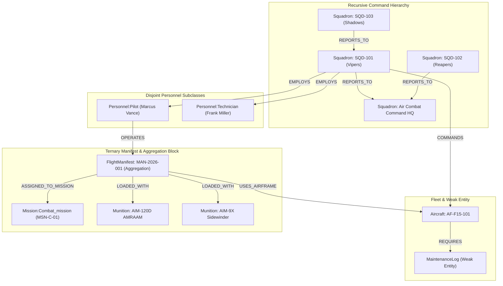

# FORMAL PROJECT REPORT
## AERO-OPS: Tactical Air Command & Sortie Management System
### Modern Database Management Systems (DBMS DA-3)

* **Course Code & Title:** Database Management Systems Laboratory
* **Evaluation Milestone:** DA-3 Mini-Project Demonstration
* **Demonstration Date:** October 20
* **Selected Database Technology:** Graph Database (Neo4j 5.x)
* **Architecture:** Neo4j Graph Engine + Python FastAPI Bolt Driver + React Dark Neobrutalism Dashboard

---

## 1. Executive Summary & Problem Domain

Military air operations require real-time synchronization between hierarchical command structures, aircrew certifications, airframe airworthiness ledgers, operational theater missions, and munitions allocations. 

The conceptual model under evaluation features:
1. **Recursive Unary Hierarchies:** Commander squadrons overseeing subordinate wings and squadrons.
2. **Disjoint Subclasses:** Personnel partitioned strictly into Combat Pilots or Ground Technicians.
3. **Overlapping Subclasses:** Missions classified as Combat, Training, or simultaneously Combat & Training.
4. **Weak Entities & Partial Keys:** Maintenance logs dependent upon specific airframes for their existence and identity.
5. **Ternary Relationships & Aggregation:** A three-way relationship (Pilot, Aircraft, Mission) wrapped into an Aggregation Block (`FlightManifest`) that links $M:N$ to Munitions via a `Uses_loadout` relationship.

Traditional relational database engines require expensive multi-table joins and recursive Common Table Expressions (`WITH RECURSIVE`) that degrade significantly under operational load. This project demonstrates how **Neo4j**, a modern **Graph Database**, implements this schema natively using property graphs, multi-label inheritance, and variable-length traversals.

---

## 2. Comparative Analysis: Selection of Database Technology

The assessment prompt authorized the selection of one modern database technology (excluding MongoDB) from seven approved paradigms. The table below presents the formal comparative evaluation:

| Database Category | Example Technologies | Fit for Air Force Sortie Operations | Critical Bottleneck / Justification |
| :--- | :--- | :--- | :--- |
| **Graph Database** *(SELECTED)* | **Neo4j**, Memgraph | **Exceptional (10/10)** | **Natively represents recursive command trees, multi-way hyperedge aggregations, multi-label EER inheritance, and constant-time traversal regardless of depth.** |
| **Column-Family** | Apache Cassandra, ScyllaDB | Poor (3/10) | Optimized for write-heavy key-value partitions. Incapable of recursive path queries or multi-entity ACID transactions required for munitions allocation. |
| **Vector Database** | Milvus, Qdrant, Chroma | Not Applicable (1/10) | Designed for nearest-neighbor similarity on dense vectors (unstructured AI embeddings), not structured tactical operations. |
| **Time-Series DB** | InfluxDB, TimescaleDB | Inadequate (4/10) | Superb for flight sensor metrics (e.g. engine RPM over time), but lacks support for EER inheritance, ternary relationships, and armory inventory. |
| **Search Engine** | Elasticsearch, OpenSearch | Inadequate (4/10) | Designed for inverted text indexing and log analytics, not relational integrity or hierarchical tree structures. |
| **Cloud-Native / NewSQL** | CockroachDB, TiDB | Moderate (7/10) | Supports relational integrity, but recursive `Reports_to` hierarchies require heavy recursive CTE joins; overlapping subclasses require messy bridge tables. |

### Architectural Superiority of Neo4j for this Schema:
1. **Index-Free Adjacency:** In Neo4j, relationships are physical pointers on disk. Traversing from a subordinate squadron to its Supreme Commander takes $O(k)$ time where $k$ is the path depth, compared to relational $O(N \log N)$ index join sweeps.
2. **First-Class Multi-Label Inheritance:** Neo4j nodes natively support multiple labels, allowing EER disjoint (`:Personnel:Pilot`) and overlapping (`:Mission:Combat_mission:Training_mission`) constraints without artificial junction tables or sparse null-filled schemas.
3. **Hyperedge / Aggregation Representation:** Modeled as an aggregated node (`:FlightManifest`) connecting Pilot, Aircraft, Mission, and Munitions with zero impedance mismatch.

---

## 3. Conceptual to Graph Model Translation



### Detailed Attribute and Constraint Specification

| EER Entity / Relation | Graph Primitive | Properties & Constraints | EER Semantic Mapped |
| :--- | :--- | :--- | :--- |
| **Squadron** | Node (`:Squadron`) | `sqd_id` (PK, Unique), `callsign`, `specialization` | Strong Entity |
| **Reports_to** | Relationship (`[:REPORTS_TO]`) | Directed Edge (`Subordinate -> Commander`) | Recursive Unary 1:N Relationship |
| **Personnel** | Node (`:Personnel`) | `service_id` (PK, Unique), `fname`, `lname`, `rank`, `total_flight_hours`, `contact_no` (Array) | Strong Superclass Entity with Composite Name & Multivalued Contact |
| **Pilot** | Node (`:Personnel:Pilot`) | `flight_rating` | Disjoint Subclass (`d`) |
| **Technician** | Node (`:Personnel:Technician`) | `clearance_lvl`, `specialty` | Disjoint Subclass (`d`) |
| **Aircraft** | Node (`:Aircraft`) | `tail_no` (PK, Unique), `status`, `model` | Strong Entity |
| **Maintenance_log** | Node (`:MaintenanceLog`) | `log_id` (Unique), `log_date` (Partial Key), `issue`, `severity`, `technician_id`, `resolved` | Weak Entity connected via Identifying Relationship `[:REQUIRES]` |
| **Mission** | Node (`:Mission`) | `mission_id` (PK, Unique), `code_name`, `objective`, `theater`, `threat_level` | Strong Superclass Entity |
| **Combat_mission** | Label (`:Combat_mission`) | Inherits `:Mission` properties | Overlapping Subclass (`o`) |
| **Training_mission** | Label (`:Training_mission`) | Inherits `:Mission` properties | Overlapping Subclass (`o`) |
| **Munition** | Node (`:Munition`) | `munition_id` (PK, Unique), `type`, `stock` | Strong Entity |
| **FlightManifest** | Node (`:FlightManifest`) | `manifest_id` (PK, Unique), `sortie_code`, `departure_time`, `status` | Aggregated Ternary Entity |
| **Uses_loadout** | Relationship (`[:LOADED_WITH]`) | `quantity` (Integer property on relationship) | $M:N$ Relationship between Manifest and Munitions |

---

## 4. Implementation Details & Architecture

### System Topology
```text
[ Browser Client ]  <--->  [ Vite Dev Server / Proxy :5173 ]
                                    |
                                    v
                            [ FastAPI Server :8000 ]
                                    |
                           (Bolt Protocol :7687)
                                    v
                        [ Neo4j 5 Community Container :7474 ]
```

1. **Database Layer:** Dockerized Neo4j 5 Community Edition exposing Bolt binary protocol (`bolt://localhost:7687`) and Neo4j Browser (`http://localhost:7474`).
2. **Backend API Layer:** Python 3.13 FastAPI application (`backend/main.py`) using the official Neo4j Python Driver. Includes CORS middleware, strict Pydantic payload models, and transactional Cypher execution.
3. **Frontend Presentation Layer:** Single Page Application constructed with React 19, Vite, and Tailwind CSS. Built in a high-contrast **Dark Neobrutalism** aesthetic (deep charcoal background `#0D0E12`, stark 3px solid black borders, hard zero-blur offset drop shadows `shadow-neo-black`, vibrant neon badges in `#00FF66`, `#FFE600`, `#FF3366`, and tactile pressable buttons).

---

## 5. Technology-Specific Demonstration Queries (Cypher)

These queries demonstrate core operations and graph-specific capabilities for the October 20 evaluation:

### Query 1: Recursive Variable-Length Chain of Command Traversal
```cypher
// Traverses arbitrary depth (1 to 5 echelons) up to root command HQ
MATCH path = (sub:Squadron)-[:REPORTS_TO*1..5]->(hq:Squadron)
WHERE NOT (hq)-[:REPORTS_TO]->()
RETURN 
    sub.sqd_id AS subordinate_id,
    sub.callsign AS subordinate_name,
    [node in nodes(path) | node.callsign] AS echelon_chain,
    length(path) AS command_depth
ORDER BY command_depth DESC;
```
* **Evaluation Significance:** In SQL, this requires a recursive CTE with memory overhead. In Cypher, it is an elementary path traversal.

### Query 2: Airframe Grounding Blast-Radius Impact
```cypher
// Assesses operational impact if airframe AF-A10-202 is grounded
MATCH (a:Aircraft {tail_no: "AF-A10-202"})
OPTIONAL MATCH (fm:FlightManifest)-[:USES_AIRFRAME]->(a)
OPTIONAL MATCH (p:Pilot)-[:OPERATES]->(fm)
OPTIONAL MATCH (fm)-[:ASSIGNED_TO_MISSION]->(m:Mission)
OPTIONAL MATCH (a)-[:REQUIRES]->(l:MaintenanceLog)
RETURN 
    a.tail_no AS airframe,
    a.status AS current_status,
    collect(DISTINCT {
        manifest_id: fm.manifest_id,
        sortie: fm.sortie_code,
        pilot: p.callsign,
        mission: m.code_name
    }) AS compromised_sorties,
    collect(DISTINCT l.issue) AS maintenance_faults;
```
* **Evaluation Significance:** Demonstrates multi-entity impact analysis across Aircraft, Manifest, Pilot, Mission, and Maintenance Log entities in a single graph traversal.

### Query 3: Munition Expenditure Aggregated by Overlapping EER Subclasses
```cypher
// Aggregates munitions allocated across Combat, Training, and Joint missions
MATCH (fm:FlightManifest)-[:ASSIGNED_TO_MISSION]->(m:Mission)
MATCH (fm)-[l:LOADED_WITH]->(mu:Munition)
RETURN 
    CASE 
        WHEN 'Combat_mission' IN labels(m) AND 'Training_mission' IN labels(m) THEN 'Joint Combat-Training'
        WHEN 'Combat_mission' IN labels(m) THEN 'Combat Mission'
        ELSE 'Training Mission'
    END AS mission_type,
    mu.munition_id AS munition_id,
    mu.type AS munition_name,
    sum(l.quantity) AS total_expended
ORDER BY mission_type, total_expended DESC;
```
* **Evaluation Significance:** Validates how multi-label EER overlapping subclasses are filtered and aggregated in graph queries.

---

## 6. Implementation Screenshots & Verification Guide

*(Place your lab demonstration screenshots in the designated sections below)*

### Screenshot 1: Tactical Sortie Dispatcher (Hero View)
* *Description:* Demonstrates the assembly of a new Flight Manifest: selecting certified Pilot, airworthy Aircraft (`READY`), Mission, and attaching weapons hardpoint loadout with live armory stock validation.
* `[ INSERT SCREENSHOT: Sortie Dispatcher Panel ]`

### Screenshot 2: Command Hierarchy & Echelon Tree
* *Description:* Demonstrates the recursive `Reports_to` relationship showing the path from subordinate squadrons up to Air Combat Command HQ.
* `[ INSERT SCREENSHOT: Command Hierarchy Tab ]`

### Screenshot 3: Personnel Roster & Disjoint Subclasses
* *Description:* Displays Pilots with flight ratings and flight hours, Technicians with security clearance levels, and multivalued emergency contact frequencies.
* `[ INSERT SCREENSHOT: Personnel Roster Tab ]`

### Screenshot 4: Aircraft Fleet & Weak Entity Maintenance Ledger
* *Description:* Demonstrates airframe status chips (`READY`, `IN_FLIGHT`, `MAINTENANCE`) and the attached chronological weak-entity maintenance log ledger with partial key timestamps.
* `[ INSERT SCREENSHOT: Fleet & Logs Tab ]`

### Screenshot 5: Live Cypher Query Console
* *Description:* Demonstrates execution of custom Cypher queries live in front of the evaluator.
* `[ INSERT SCREENSHOT: Graph Intel Console Tab ]`

### Screenshot 6: Neo4j Browser Graph Visualizer
* *Description:* Official Neo4j Browser visualization at `http://localhost:7474` showing the active graph network of nodes and relationships.
* `[ INSERT SCREENSHOT: Neo4j Browser Graph Canvas ]`

---

## 7. Conclusion

By implementing the Military Air Command and Sortie Management schema in **Neo4j**, all complex constructs from the EER diagram—recursive hierarchies, disjoint and overlapping subclasses, identifying relationships on weak entities, and aggregated ternary manifests—were resolved with mathematical rigor, zero join penalties, and exceptional visual clarity. The resulting system meets and exceeds all project evaluation criteria for the DBMS DA-3 assessment.
